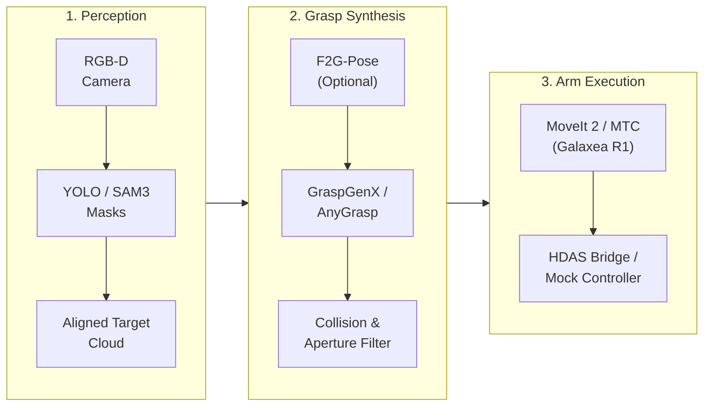

# Grasping & manipulation

End-to-end ROS 2 Humble perception, 6-DoF grasp synthesis, pose registration, cabinet perception, and arm motion planning. The grasping workspace (`public-core-grasp`) is decoupled from robot-specific arm controllers so you can reuse the perception and grasp synthesis pipeline on any robot arm and gripper.

## Data flow

## Component breakdown

### Part 1: Targeted Object Segmentation
*Packages: [`public-perc-yolo_segmenter`](https://github.com/Team-Robo/public-perc-yolo_segmenter), [`public-perc-sam_segmenter`](https://github.com/Team-Robo/public-perc-sam_segmenter)*

- **What it does:** `yolo_segmenter` provides continuous C++ ONNX/TensorRT instance segmentation with ByteTrack tracking; `sam_segmenter` provides on-demand text-prompted segmentation using SAM 3 (C++ GGML or Python worker).
- **How to use on your own robot:** Both are tracked as submodules inside `public-core-grasp` and can also be built independently (with `core_r1_interfaces` and `grasp_pipeline`) to publish `/perc/grasp/instances` for any RGB camera stream.

### Part 2: 3D Shape Completion & Known-Object Pose
*Packages: [`public-manip-f2g_pose_ros2`](https://github.com/Team-Robo/public-manip-f2g_pose_ros2), [`public-core-mac_registration`](https://github.com/Team-Robo/public-core-mac_registration)*

- **What it does:** `f2g_pose_ros2` reconstructs a complete 3D object shape and 6-DoF pose from a single head-camera view and optionally fuses it with a live wrist-camera point cloud via ICP. `mac_registration` aligns a known reference object cloud against live depth clouds using Maximal Cliques (MAC) with quality gating.
- **How to use on your own robot:** Use `f2g_pose_ros2` standalone (`direct_head` mode) or inside `public-core-grasp` (`fusion` mode). `mac_registration` is **completely standalone** on any `sensor_msgs/PointCloud2` topic.

### Part 3: Grasping Workspace (`public-core-grasp`)
*Package: [`public-core-grasp`](https://github.com/Team-Robo/public-core-grasp)*

- **What it does:** Bundles 5 core packages — [`src/core-r1_interface`](https://github.com/Team-Robo/public-core-grasp/tree/main/src/core-r1_interface), [`src/perc-object_pointcloud`](https://github.com/Team-Robo/public-core-grasp/tree/main/src/perc-object_pointcloud), [`src/manip-grasp_bringup`](https://github.com/Team-Robo/public-core-grasp/tree/main/src/manip-grasp_bringup), [`src/manip-graspgenx_ros2`](https://github.com/Team-Robo/public-core-grasp/tree/main/src/manip-graspgenx_ros2), and [`src/manip-anygrasp_ros2`](https://github.com/Team-Robo/public-core-grasp/tree/main/src/manip-anygrasp_ros2) — plus the YOLO, SAM3, F2G-Pose, and AnyGrasp SDK submodules. Extracts aligned target + scene clouds, runs either GraspGenX (default C++ TensorRT/CUDA) or AnyGrasp, filters candidates against gripper geometry and collisions, and visualizes results in Rerun.
- **How to use on your own robot:** Clone recursively, create the Conda environment from `environment.yml`, point the launch file at your RGB-D camera topics, and select a gripper profile (`galaxea_g1`, `openarm_1_0`, or add your own parallel-jaw JSON profile). In the grasp frame, `+Z` is the approach axis and `+X` is the closing axis.

### Part 4: Cabinet & Shelf Perception
*Package: [`public-perc-cabinet_perception`](https://github.com/Team-Robo/public-perc-cabinet_perception)*

- **What it does:** Pure geometric RGB-D perception (NumPy + SciPy) that detects shelf boards, segments each level into cubbies, assigns objects to cubbies, and measures free placement space (`CabinetScene`).
- **How to use on your own robot:** **Standalone** (includes vendored `object_grouping_interfaces`). Supply an RGB-D camera, optional cabinet prior YAML, and instance masks to get structured shelf/cubby geometry for pick-and-place planning.

### Part 5: Arm Motion Planning & Execution (Galaxea R1)
*Package: [`public-manip-R1`](https://github.com/Team-Robo/public-manip-R1)*

- **What it does:** Provides the `r1_v2_1_0` URDF, MoveIt 2 configuration (`r1_moveit_config`), MoveIt Task Constructor pick-and-place planner (`robot_mtc` / `r1_mtc_api`), Python manipulation client (`r1_api`), and hand–eye camera calibration tools (`calibration` + `moveit_calibration`).
- **How to use on your own robot:** Galaxea R1 users can run mock or hardware execution directly via the launch files. Teams with other arms can adapt `robot_mtc`'s robot-profile YAML layout and `r1_api`'s `GraspClient` to connect `public-core-grasp` to their own MoveIt 2 setup.

## Key ROS interfaces

| Part | Package | Primary ROS 2 Interface |
| --- | --- | --- |
| Segmentation | `public-perc-yolo_segmenter` / `sam_segmenter` | `/perc/grasp/instances` (`InstanceSegmentation`) |
| Point cloud & grasp | `public-core-grasp` | `/perc/grasp/target_cloud`, `GetGrasps` (srv), `/manip/grasp/result` |
| Known-object pose | `public-core-mac_registration` | `~/input_cloud`, `~/pose` (`Detection3D`) |
| Cabinet perception | `public-perc-cabinet_perception` | `/perception/cabinet/scene` (`CabinetScene`) |
| Arm execution | `public-manip-R1` | MoveIt 2 `move_group`, `PlanPick` / MTC services |
