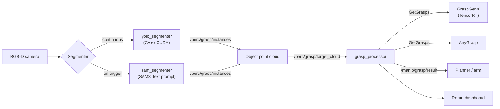

# Grasping

!!! note "Coming soon"
    The grasping repositories are being prepared for public release. Links on this page will
    work once they are published.

[`core-grasp`](https://github.com/Team-Robo/core-grasp) is a ROS 2 Humble workspace that pulls
the grasping stack together as Git submodules. It segments a named target object, builds an
aligned point cloud of it, and synthesises ranked 6-DoF grasps with a choice of backends.

```bash
git clone --recurse-submodules https://github.com/Team-Robo/core-grasp.git
```

## Pipeline



1. **Segmentation.** In continuous mode, a C++ YOLO segmenter tracks COCO-class targets at camera
   frame rate. In trigger mode, a C++ GGML build of SAM3 segments whatever the text prompt names
   (for example `red cup` or `cup,bottle`), with no separate detector.
2. **Point cloud.** RGB and depth images are paired by their exact capture time. The mask is then
   back-projected into a target cloud, and the surrounding scene is kept as collision evidence.
3. **Grasp synthesis.** `grasp_processor` sends the cloud to the selected backend. It then applies
   GPU collision checks against the gripper CAD model, spatial non-maximum suppression and
   aperture checks, and publishes ranked candidates on `/manip/grasp/result`. In every output,
   +Z is the approach direction and +X is the closing direction.
4. **Visualisation.** A native C++ Rerun dashboard shows the 3D scene and grasp candidates, the
   RGB image with detections, aligned depth, and pipeline metrics on one screen.

## Running it

```bash
# Continuous YOLO segmentation + GraspGenX
ros2 launch grasp_bringup manip_bringup.launch.py \
  camera_type:=d405 single_frame_mode:=false target_object:=cup

# Triggered SAM3 segmentation + GraspGenX
ros2 launch grasp_bringup manip_bringup.launch.py \
  camera_type:=d405 single_frame_mode:=true target_object:=cup
ros2 service call /manip/grasp/trigger std_srvs/srv/Trigger '{}'
```

Use `grasp_backbone:=anygrasp` to switch backends, `gripper_id:=openarm_1_0` for the OpenArm
gripper, and `camera_type:=bag bag_path:=<bag>` to replay a recording.

## Backends and grippers

| Backend                                                                    | Notes                                                                                                    |
| -------------------------------------------------------------------------- | -------------------------------------------------------------------------------------------------------- |
| [`manip-graspgenx_ros2`](https://github.com/Team-Robo/manip-graspgenx_ros2) | Default. Native C++ TensorRT/CUDA runtime for NVIDIA GraspGenX (Apache-2.0). Checkpoints are fetched from Hugging Face. |
| [`manip-anygrasp_ros2`](https://github.com/Team-Robo/manip-anygrasp_ros2)   | Adapter only. The AnyGrasp SDK binaries, licence and weights must be obtained separately from the AnyGrasp authors. |

Supported grippers:

- **Galaxea G1**: parallel-jaw gripper with a 100 mm stroke (`galaxea_g1`).
- **OpenArm 1.0**: parallel-jaw gripper with an 88 mm stroke (`openarm_1_0`).

!!! warning
    The grasp poses are based on reference geometry only. They are not calibrated to a robot's
    tool centre point and are not a guarantee of physical grasp success. Calibrate for your own
    setup before executing grasps on hardware.

## Known-object pose

For objects whose shape is known in advance,
[`core-mac_registration`](https://github.com/Team-Robo/core-mac_registration) estimates a 6-DoF
pose by registering the object's point cloud against a reference capture with Maximal Cliques
(MAC). It refuses to publish a pose when the match quality is low. This lets a grasp that was
planned once be reused after the object moves.
