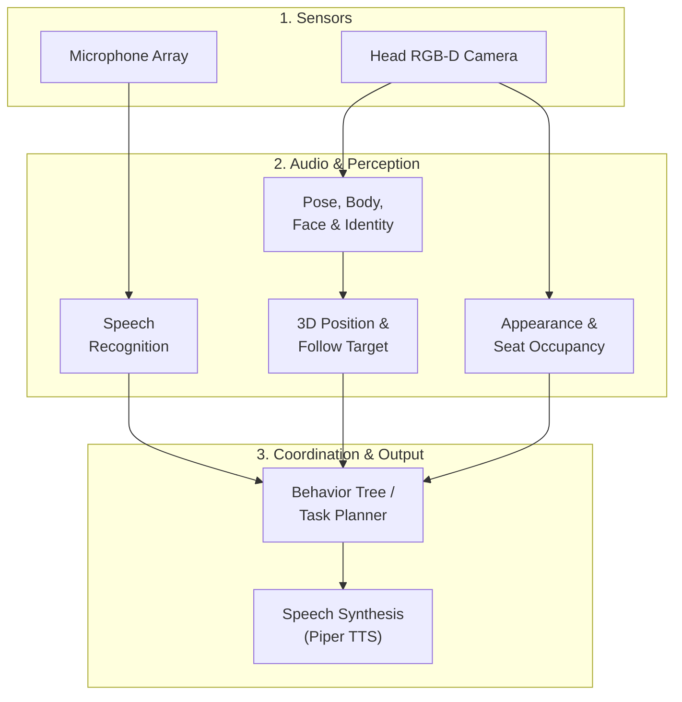

# Audio & HRI

Modular ROS 2 Humble packages for on-device speech interaction, multi-person tracking and identity fusion, appearance description, and 3D seat occupancy detection. Each part communicates over standard ROS 2 topics, services, and actions so you can run the full chain or adopt individual nodes.

## Data flow

## Component breakdown

### Part 1: Offline Speech I/O
*Packages: [`public-audio-speech_input`](https://github.com/Team-Robo/public-audio-speech_input), [`public-audio-speech_output`](https://github.com/Team-Robo/public-audio-speech_output)*

- **What it does:** Runs voice activity detection (Silero VAD) and `whisper.cpp` speech-to-text locally, and synthesizes speech on CPU with Piper (`sherpa-onnx`) with priority-based interruption and resumable playback.
- **How to use on your own robot:** Both packages are **completely standalone** — connect a USB microphone and speaker, launch the nodes, and send goals to `/speech/listen` and `/speech/speak` from any ROS 2 client or behavior tree.

### Part 2: Person Detection, Re-ID & Identity Fusion
*Packages: [`public-perc-person_pose`](https://github.com/Team-Robo/public-perc-person_pose), [`public-perc-person_body`](https://github.com/Team-Robo/public-perc-person_body), [`public-perc-person_face`](https://github.com/Team-Robo/public-perc-person_face), [`public-perc-person_identity`](https://github.com/Team-Robo/public-perc-person_identity)*

- **What it does:** `person_pose` (MMDeploy RTMDet + RTMPose) detects COCO-17 body keypoints; `person_body` (BoxMOT) assigns persistent whole-body track IDs and appearance embeddings; `person_face` (InsightFace) handles on-demand enrollment and recognition against a local `face_db.json`; `person_identity` fuses face IDs and body tracks using timestamped head-region matching.
- **How to use on your own robot:** `person_pose` runs **standalone** on any RGB image topic (`/camera/color/image_raw`). Add `person_body` or `person_face` as needed, and add `person_identity` when you want unified per-person IDs that survive turn-arounds and occlusion.

### Part 3: 3D Person Tracking & Follow Target
*Packages: [`public-perc-person_position`](https://github.com/Team-Robo/public-perc-person_position), [`public-perc-person_follow_target`](https://github.com/Team-Robo/public-perc-person_follow_target)*

- **What it does:** `person_position` projects tracked bodies into 3D coordinates and velocities using aligned depth; `person_follow_target` locks onto a single chosen person and reacquires them after occlusion using body embeddings.
- **How to use on your own robot:** Feed an aligned RGB-D depth topic plus `person_body` and `person_pose` outputs, then pass `/perception/person_follow_target/position` directly into your own navigation controller.

### Part 4: Visual Appearance Description
*Package: [`public-perc-person_description`](https://github.com/Team-Robo/public-perc-person_description)*

- **What it does:** Classifies hair color, clothing color, glasses, and hat on tracked people using CLIP zero-shot classification (default, with optional local Qwen2.5-VL or Groq API backends). Only attributes above the confidence threshold are reported.
- **How to use on your own robot:** Run alongside the person-tracking nodes and call `/perception/people/describe` whenever your task planner needs a structured visual description of a person.

### Part 5: 3D Seat Occupancy Detection
*Package: [`public-perc-seating_detection`](https://github.com/Team-Robo/public-perc-seating_detection)*

- **What it does:** Detects chairs, couches, and benches in 3D on CPU from RGB-D depth, maintains a persistent seat registry across occlusions, and classifies each seat as `FREE`, `PERSON`, `OBJECT`, or `UNKNOWN`.
- **How to use on your own robot:** Runs **standalone** with any RealSense/RGB-D camera (optionally using `person_pose` for hip keypoints, or falling back to YOLO). Call `/perception/seats/detect` to get 3D poses of unoccupied seats.

## Key ROS interfaces

| Part | Package | Primary ROS 2 Interface |
| --- | --- | --- |
| Speech I/O | `public-audio-speech_input` / `output` | `/speech/listen` (action), `/speech/speak` (action) |
| Person pose & tracking | `public-perc-person_pose` / `body` | `/perception/people/poses`, `/perception/people/bodies` |
| Face & identity | `public-perc-person_face` / `identity` | `/perception/people/identities/enroll` (action), `/perception/people/identities` |
| 3D follow target | `public-perc-person_position` / `follow_target` | `/perception/people/positions`, `/perception/person_follow_target/position` |
| Appearance | `public-perc-person_description` | `/perception/people/describe` (service) |
| Seat occupancy | `public-perc-seating_detection` | `/perception/seats/detect` (service), `/perception/seats` |
