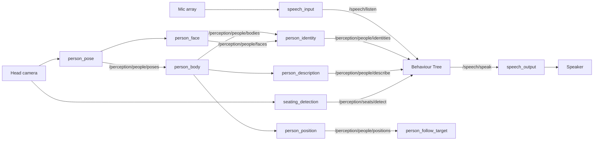

# HRI Challenge

The RoboCup@Home HRI Challenge asks the robot to receive guests at a party. It must notice
arriving guests, learn their names and favourite drinks, introduce them to the host and each
other, describe one guest to another, and offer each guest a free seat.

Our behaviour tree drives the task. Each leaf of the tree is served by one of the released
repositories:

| Behaviour-tree leaf                                    | Repository                                                                                   |
| ------------------------------------------------------ | -------------------------------------------------------------------------------------------- |
| `ListenForSpeech`                                      | [`audio-speech_input`](https://github.com/Team-Robo/audio-speech_input)                       |
| `Speak`                                                | [`audio-speech_output`](https://github.com/Team-Robo/audio-speech_output)                     |
| `DetectPerson`                                         | [`perc-person_pose`](https://github.com/Team-Robo/perc-person_pose)                           |
| `EnrollPerson`, `IdentifyPerson`, `ClearRegistrations` | [`perc-person_face`](https://github.com/Team-Robo/perc-person_face)                           |
| `TrackIdentity`                                        | [`perc-person_identity`](https://github.com/Team-Robo/perc-person_identity), fed by [`perc-person_body`](https://github.com/Team-Robo/perc-person_body) |
| `DescribeAppearance`                                   | [`perc-person_description`](https://github.com/Team-Robo/perc-person_description)             |
| `SeatGuest`                                            | [`perc-seating_detection`](https://github.com/Team-Robo/perc-seating_detection)               |

[`perc-person_position`](https://github.com/Team-Robo/perc-person_position) and
[`perc-person_follow_target`](https://github.com/Team-Robo/perc-person_follow_target) provide
the per-person 3D target that navigation needs to escort or follow a person.

## Data flow

## Listening and speaking

**Task:** Ask each guest for their name and favourite drink, and talk to the guests and the host.

**Main Challenge:** A party is noisy, and the robot cannot rely on a network connection.

**Our Approach:** `audio-speech_input` runs entirely on the robot. Audio from the ReSpeaker XVF3800
array goes through voice activity detection and then whisper.cpp on CUDA, and callers can pass a
vocabulary hint (for example, a list of names or drinks). `audio-speech_output` runs Piper voices
on the CPU and splits text into sentences. Each request has a priority: a higher-priority message,
such as a battery alert, interrupts a long reply, and the reply then resumes from just before the
point where it was cut off.

## Recognising people

**Task:** Remember each guest and recognise them again later, even after they move around the room.

**Main Challenge:** Faces are only visible some of the time, and body tracks can swap or break
when people overlap.

**Our Approach:** Three pipelines work together:

- `perc-person_pose` detects people and their keypoints.
- `perc-person_body` gives each person a whole-body track id and an appearance embedding that
  survives turning around and occlusion.
- `perc-person_face` matches faces on demand.

`perc-person_identity` is the link between them. It assigns face ids to body tracks using
capture-time matching and head-region scoring, so each person keeps one canonical identity even
when their face is hidden.

## Describing a guest

**Task:** Describe the first guest to the second guest.

**Main Challenge:** Each attribute is scored right or wrong, and a wrong guess loses points. A
confident but wrong description is worse than saying nothing.

**Our Approach:** `perc-person_description` uses CLIP zero-shot classification for hair colour,
clothing colour, glasses and hat. It only reports attributes that clear a confidence threshold.
We tried generative VLMs as backends and they still work as fallbacks, but in live tests they
produced malformed output and confidently wrong attributes. CLIP's fixed set of labels cannot fail
in those ways.

## Offering a free seat

**Task:** Offer the new guest a free seat.

**Main Challenge:** A seat with someone sitting on it can be hidden from view. A seat can also be
taken by a bag or laptop instead of a person.

**Our Approach:** `perc-seating_detection` fits the floor from head-camera depth and turns YOLO
seat detections into 3D seats. It keeps them in a registry that remembers each seat while it is
hidden. A small state machine then labels each seat **free**, **person**, **object** or
**unknown**, and only free seats are offered. The node runs on the CPU, so the GPU stays free for
the other perception nodes.
