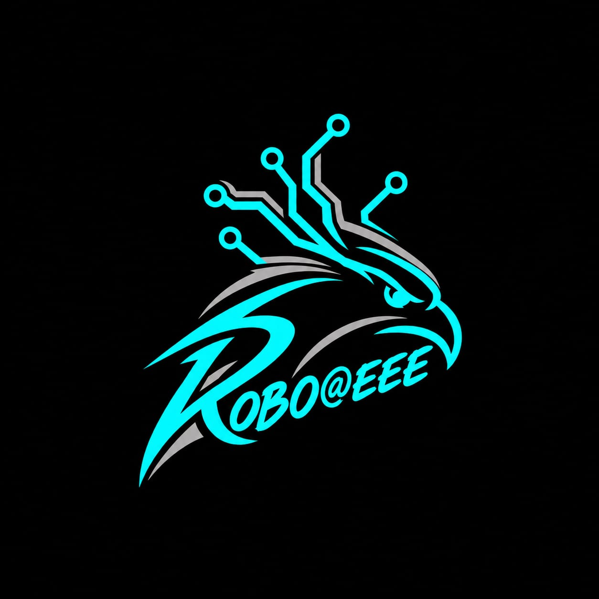

---
hide:
  - navigation
  - toc
---

<canvas class="overview-hero__canvas" aria-hidden="true"></canvas>

# Robo@EEE Software Release

Open-source software portal for **Team Robo** at Nanyang Technological University, Singapore.
Explore our modular ROS 2 Humble service-robot stack (speech, perception, grasping, manipulation,
semantic mapping, and operator tools) alongside our ROS 1 Noetic BARN Challenge navigation
repositories.

[Browse repositories](projects.md){ .md-button .md-button--primary }
[Explore architecture](stack.md){ .md-button }

[Official team website](https://robo-eee-web.vercel.app/)

  

  <input class="md-visually-hidden overview-hero__pause" type="checkbox" id="overview-pause">
  <label class="overview-hero__control" for="overview-pause" title="Pause background animation">
    Pause background animation
  </label>

