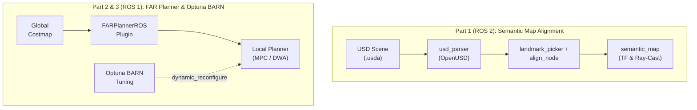

# Navigation & mapping

Two independent toolchains: **ROS 2 Humble** semantic scene alignment for querying 3D object geometry against a 2D SLAM map, and **ROS 1 Noetic** dynamic visibility-graph global planning with automated Optuna hyperparameter tuning.

## Data flow

## Component breakdown

### Part 1: OpenUSD Semantic Map Alignment (ROS 2 Humble)
*Package: [`public-nav-semantic_map`](https://github.com/Team-Robo/public-nav-semantic_map)*

- **What it does:** Parses object and wall bounding boxes from a `.usda` scene (`usd_parser`), aligns them interactively against a 2D SLAM occupancy map in RViz (`landmark_picker.py` + `align_node.py`), and at runtime broadcasts the static transform `map -> usd_world` while serving ray-cast ("what is the robot looking at?") and object-lookup queries.
- **How to use on your own robot:** **Standalone** on any ROS 2 Humble robot with a 2D occupancy map. Run the offline export + RViz alignment once to generate `alignment.yaml`, then launch `semantic_map.py` alongside your navigation stack.

### Part 2: FAR Planner `move_base` Plugin (ROS 1 Noetic)
*Package: [`public-nav-far-planner`](https://github.com/Team-Robo/public-nav-far-planner)*

- **What it does:** Wraps upstream FAR Planner (dynamic visibility-graph route planning) as a drop-in `nav_core::BaseGlobalPlanner` plugin (`far_planner/FARPlannerROS`) with robot-centered costmap windowing and per-step timing benchmarks.
- **How to use on your own robot:** Build with `catkin_make` in a ROS 1 Noetic workspace and set `<param name="base_global_planner" value="far_planner/FARPlannerROS" />` in your existing `move_base` launch file alongside any local planner (DWA, TEB, EBand, or MPC).

### Part 3: Automated BARN Planner Tuning (ROS 1 Noetic)
*Package: [`public-nav-optuna_barn`](https://github.com/Team-Robo/public-nav-optuna_barn)*

- **What it does:** Runs closed-loop Optuna hyperparameter optimization across BARN Gazebo benchmark worlds, updating planner parameters via `dynamic_reconfigure` and logging trial scores to CSV and SQLite (`optuna-dashboard`).
- **How to use on your own robot:** Clone alongside `the-barn-challenge` (or Team Robo's official BARN Challenge repositories: [`mlda-barn-2024`](https://github.com/Team-Robo/mlda-barn-2024), [`mlda-barn-2025`](https://github.com/Team-Robo/mlda-barn-2025), [`the_barn_challenge_robo`](https://github.com/Team-Robo/the_barn_challenge_robo)), define your planner's `dynamic_reconfigure` parameter search space in a YAML file under `configs/` (using `dwa.yaml`, `eband.yaml`, or `msmpcv1dot3.yaml` as templates), and run `run_optuna.py`.

## Key ROS interfaces

| Part | Package | ROS Distro | Primary Interface |
| --- | --- | --- | --- |
| Semantic map | `public-nav-semantic_map` | ROS 2 Humble | Static TF `map -> usd_world`, `/semantic_boxes`, ray-cast & find-objects services |
| Global planner | `public-nav-far-planner` | ROS 1 Noetic | `move_base` `BaseGlobalPlanner` plugin (`far_planner/FARPlannerROS`) |
| Planner tuning | `public-nav-optuna_barn` | ROS 1 Noetic | `dynamic_reconfigure` client + `move_base` action monitoring |
