# Architecture

Team Robo's software stack runs primarily on **ROS 2 Humble** (Ubuntu 22.04), with a companion **ROS 1 Noetic** toolchain for `move_base` global planning and BARN benchmarking. Every subsystem is packaged as modular repositories so other teams can either adopt a full pipeline or drop individual nodes into their own robot.

```mermaid
flowchart LR
    subgraph S["1. Sensors"]
        direction TB
        Mic["USB Mic<br/>Array"]
        Cam["RGB-D<br/>Cameras"]
    end

    subgraph P["2. Perception"]
        direction TB
        Aud["Speech<br/>(STT / TTS)"]
        Per["Person & Seat<br/>Perception"]
        Obj["Object & Cabinet<br/>Perception"]
    end

    subgraph E["3. Planning"]
        direction TB
        HRI["HRI<br/>Coordination"]
        Grp["Grasping &<br/>MoveIt 2"]
        Nav["Semantic Map<br/>& FAR Planner"]
    end

    subgraph T["4. Ops & UI"]
        direction TB
        Sch["Node<br/>Scheduler"]
        UI["Dashboard &<br/>Robot Face"]
        Rec["Robot<br/>Recorder"]
    end

    S --> P --> E <--> T
```

## Choose a stack guide

| Subtab | What it covers | How to reuse on your own robot |
| --- | --- | --- |
| [Audio & HRI](hri.md) | Offline speech I/O, person pose/body/face/identity/3D tracking, appearance description, and seat occupancy | Pick individual ROS 2 nodes (e.g., standalone STT/TTS or pose/seating) or wire the full person-tracking chain to your own behavior tree. |
| [Grasping & manipulation](grasping.md) | Targeted segmentation (YOLO / SAM3), F2G-Pose completion, GraspGenX / AnyGrasp synthesis, cabinet perception, and Galaxea R1 MoveIt 2 / MTC | Use `public-core-grasp` with any RGB-D camera + custom gripper profile, or reuse individual segmenters, `mac_registration`, and `cabinet_perception` independently. |
| [Navigation & mapping](navigation.md) | OpenUSD-to-SLAM semantic map alignment (ROS 2) and FAR Planner + Optuna BARN tuning (ROS 1) | Drop `semantic_map` onto any ROS 2 2D SLAM map, or plug `FARPlannerROS` and `optuna_barn` into any ROS 1 `move_base` stack. |
| [System tools & UI](tools.md) | Multi-machine node lifecycle scheduling, web dashboard, synchronized bag recording, and robot face display | All 4 tools are robot-agnostic ROS 2 packages configured via YAML files and work on any ROS 2 Humble robot. |

For the full list of all public repositories, see [Repositories](projects.md).
