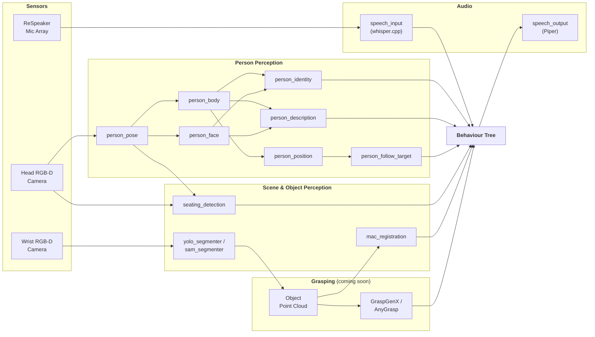

# Team Robo Software Stack Overview

This page gives an overview of our RoboCup@Home software architecture and maps out the
individual Git repositories. See each repository's README for setup, parameters and launch
files.

All repositories are ROS 2 Humble packages for Ubuntu 22.04. On the robot, they run on the
Galaxea R1's Jetson AGX Orin computers with Intel RealSense cameras and a ReSpeaker XVF3800
microphone array.

## Architecture

## Audio

| Repository                                                                    | What it does                                                                                                         |
| ----------------------------------------------------------------------------- | -------------------------------------------------------------------------------------------------------------------- |
| [`audio-speech_input`](https://github.com/Team-Robo/audio-speech_input)       | Offline speech-to-text: capture → voice activity detection → whisper.cpp, served as a `ListenForSpeech` action.     |
| [`audio-speech_output`](https://github.com/Team-Robo/audio-speech_output)     | CPU text-to-speech with Piper voices (sherpa-onnx), with priority preemption and resumable speech.                 |

## Person Perception

| Repository                                                                                | What it does                                                                                              |
| ----------------------------------------------------------------------------------------- | --------------------------------------------------------------------------------------------------------- |
| [`perc-person_pose`](https://github.com/Team-Robo/perc-person_pose)                       | C++ top-down pose estimation (RTMDet + RTMPose via MMDeploy, TensorRT or ONNX Runtime), COCO-17 keypoints. |
| [`perc-person_body`](https://github.com/Team-Robo/perc-person_body)                       | Whole-body re-ID and multi-person tracking (BoxMOT), giving stable track ids and appearance embeddings.    |
| [`perc-person_face`](https://github.com/Team-Robo/perc-person_face)                       | On-demand face enrollment and recognition with a local face database.                                     |
| [`perc-person_identity`](https://github.com/Team-Robo/perc-person_identity)               | Fuses face ids and body track ids into one canonical identity per person.                                 |
| [`perc-person_position`](https://github.com/Team-Robo/perc-person_position)               | Kalman-filtered 3D torso position and velocity of each tracked person from RGB-D depth.                   |
| [`perc-person_follow_target`](https://github.com/Team-Robo/perc-person_follow_target)     | Single-target re-acquisition for person following, using an online ridge classifier over body embeddings. |
| [`perc-person_description`](https://github.com/Team-Robo/perc-person_description)         | Confidence-gated appearance description (hair, clothing, glasses, hat) via CLIP zero-shot classification. |

## Scene and Object Perception

| Repository                                                                        | What it does                                                                                                 |
| --------------------------------------------------------------------------------- | ------------------------------------------------------------------------------------------------------------ |
| [`perc-seating_detection`](https://github.com/Team-Robo/perc-seating_detection)   | Finds chairs, couches and benches in 3D, remembers them, and labels each seat free, person, object or unknown. |
| [`perc-yolo_segmenter`](https://github.com/Team-Robo/perc-yolo_segmenter)         | Single-pass YOLO instance segmentation with a GPU-native C++ node (custom CUDA kernels, ONNX Runtime).      |
| [`perc-sam_segmenter`](https://github.com/Team-Robo/perc-sam_segmenter)           | Detector-free, text-prompted SAM3 segmentation with a native C++ GGML engine.                               |
| [`core-mac_registration`](https://github.com/Team-Robo/core-mac_registration)     | Known-object 6-DoF pose from depth point clouds using Maximal Cliques registration, with a quality gate.    |

## Manipulation

!!! note "Coming soon"
    These repositories are being prepared for release. See [Grasping](grasping.md) for details.

| Repository                                                                     | What it does                                                                                     |
| ------------------------------------------------------------------------------ | ------------------------------------------------------------------------------------------------ |
| [`core-grasp`](https://github.com/Team-Robo/core-grasp)                         | Grasping workspace: targeted segmentation → aligned point cloud → selectable grasp synthesis.   |
| [`manip-grasp_bringup`](https://github.com/Team-Robo/manip-grasp_bringup)       | Launch orchestration, grasp coordination, collision filtering and the Rerun dashboard.          |
| [`manip-graspgenx_ros2`](https://github.com/Team-Robo/manip-graspgenx_ros2)     | Native C++ TensorRT backend for NVIDIA GraspGenX 6-DoF grasp generation.                         |
| [`manip-anygrasp_ros2`](https://github.com/Team-Robo/manip-anygrasp_ros2)       | Adapter for the AnyGrasp SDK behind the shared grasp interface (SDK and weights not included).  |
