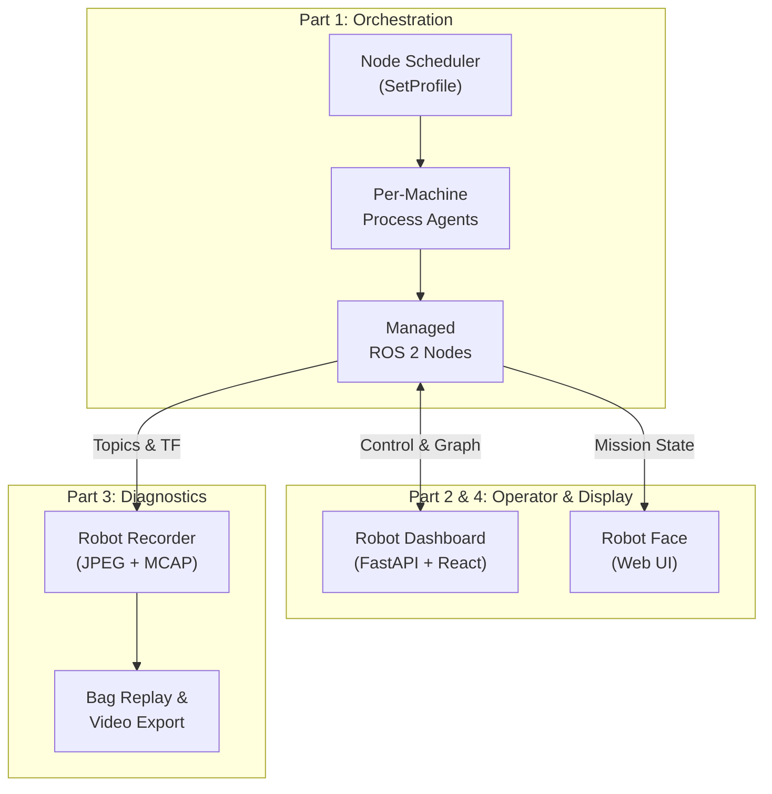

# System tools & UI

Robot-agnostic ROS 2 Humble tooling for multi-machine lifecycle orchestration, web-based operator control, compressed diagnostic recording, and an animated robot face display. All four packages work **standalone** and are configured through YAML files.

## Data flow

## Component breakdown

### Part 1: Profile-Based Node Scheduler
*Package: [`public-core-node_scheduler`](https://github.com/Team-Robo/public-core-node_scheduler)*

- **What it does:** Starts, stops, activates, pauses, or unloads ROS 2 nodes across one or more machines based on named task **profiles** (e.g., `find_seat`), respecting node dependency graphs and per-machine GPU memory budgets.
- **How to use on your own robot:** Try it immediately with the included `demo_fakes.yaml` config, then copy `robot.yaml` to declare your own nodes, machines, GPU budgets, and profiles. Call the `SetProfile` action from your behavior tree or CLI.

### Part 2: Web Robot Dashboard
*Package: [`public-ui-robot_dashboard`](https://github.com/Team-Robo/public-ui-robot_dashboard)*

- **What it does:** Serves a FastAPI backend and React/Vite UI from a single ROS 2 node for process start/stop/restart, software e-stop, live ROS 2 graph/topic/rate inspection, parameter hotloading, and behavior tree visualization.
- **How to use on your own robot:** **Standalone** — edit `config/targets.yaml` with your robot's launch targets (and optionally `config/behavior_trees.yaml` for BT visualization), launch `dashboard.launch.py`, and open the web UI from any browser on the LAN.

### Part 3: Synchronized Robot Recorder
*Package: [`public-tools-robot_recorder`](https://github.com/Team-Robo/public-tools-robot_recorder)*

- **What it does:** Compresses live camera streams to JPEG on the robot and records synchronized perception, speech, BT, and navigation/TF topics into MCAP/SQLite3 bags, with built-in replay (`play.py`) and multi-pane video export (`export_video.py`).
- **How to use on your own robot:** **Standalone** — run `ros2 run robot_recorder record`, or pass `--config my_topics.yaml` to customize topic groups for your own robot's namespaces.

### Part 4: Animated Robot Face Display
*Package: [`public-ui-robot_face`](https://github.com/Team-Robo/public-ui-robot_face)*

- **What it does:** Subscribes to behavior tree mission status and e-stop topics, maps active states to emotions via `config/expressions.yaml`, and renders an animated face page (`:8770/`) plus a debug view (`:8770/debug`).
- **How to use on your own robot:** **Standalone** — edit `config/expressions.yaml` to map your own task/node names to expressions, launch `robot_face.launch.py`, and open `http://<robot>:8770/` in any kiosk browser.

## Key ROS interfaces

| Part | Package | Primary ROS 2 Interface |
| --- | --- | --- |
| Node scheduler | `public-core-node_scheduler` | `~/set_profile` (`SetProfile` action), `~/set_target` (srv), `~/status` |
| Robot dashboard | `public-ui-robot_dashboard` | HTTP/WebSocket UI (`:8080`), ROS 2 graph & parameter introspection |
| Robot recorder | `public-tools-robot_recorder` | `ros2 bag record` (MCAP/SQLite3) + on-the-fly `/compressed` JPEG topics |
| Robot face | `public-ui-robot_face` | `/behaviour_tree/mission_status`, `/behaviour_tree/active_leaf`, `/robot_face/state` |
